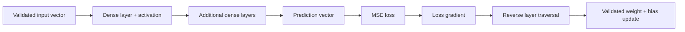
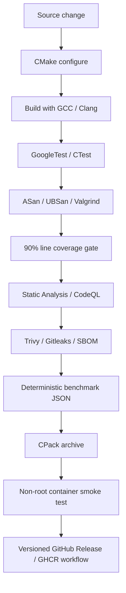

# Neural Network from Scratch in C++

<p align="center">
  <a href="https://github.com/CoreyLeath-code/neural-network-from-scratch-cpp/actions/workflows/ci.yml"></a>
  <a href="https://github.com/CoreyLeath-code/neural-network-from-scratch-cpp/actions/workflows/static-analysis.yml"></a>
  <a href="https://github.com/CoreyLeath-code/neural-network-from-scratch-cpp/actions/workflows/security.yml"></a>
  <a href="https://github.com/CoreyLeath-code/neural-network-from-scratch-cpp/actions/workflows/codeql.yml"></a>
  <a href="https://github.com/CoreyLeath-code/neural-network-from-scratch-cpp/actions/workflows/release.yml"></a>
</p>

<p align="center">
  <a href="https://github.com/CoreyLeath-code/neural-network-from-scratch-cpp/blob/main/CMakeLists.txt"></a>
  <a href="https://github.com/CoreyLeath-code/neural-network-from-scratch-cpp/blob/main/CMakeLists.txt"></a>
  <a href="https://github.com/CoreyLeath-code/neural-network-from-scratch-cpp/blob/main/tests/test_network.cpp"></a>
  <a href="https://github.com/CoreyLeath-code/neural-network-from-scratch-cpp/blob/main/.github/workflows/ci.yml">=90%" src="https://img.shields.io/badge/line%20coverage-%E2%89%A590%25-brightgreen"></a>
  <a href="https://github.com/CoreyLeath-code/neural-network-from-scratch-cpp/blob/main/.github/workflows/ci.yml"></a>
  <a href="https://github.com/CoreyLeath-code/neural-network-from-scratch-cpp/blob/main/.github/workflows/ci.yml"></a>
</p>

<p align="center">
  <a href="https://github.com/CoreyLeath-code/neural-network-from-scratch-cpp/blob/main/.github/workflows/security.yml"></a>
  <a href="https://github.com/CoreyLeath-code/neural-network-from-scratch-cpp/blob/main/.github/workflows/security.yml"></a>
  <a href="https://github.com/CoreyLeath-code/neural-network-from-scratch-cpp/blob/main/.github/workflows/security.yml"></a>
  <a href="https://github.com/CoreyLeath-code/neural-network-from-scratch-cpp/blob/main/CMakeLists.txt"></a>
  <a href="https://github.com/CoreyLeath-code/neural-network-from-scratch-cpp/blob/main/Dockerfile"></a>
  <a href="https://github.com/CoreyLeath-code/neural-network-from-scratch-cpp/blob/main/Dockerfile"></a>
  
</p>

<p align="center">
  <a href="https://github.com/CoreyLeath-code/neural-network-from-scratch-cpp/blob/main/benchmarks/benchmark_network.cpp"></a>
  <a href="https://github.com/CoreyLeath-code/neural-network-from-scratch-cpp/blob/main/benchmarks/benchmark_network.cpp"></a>
  <a href="https://github.com/CoreyLeath-code/neural-network-from-scratch-cpp/blob/main/benchmarks/benchmark_network.cpp"></a>
  <a href="https://github.com/CoreyLeath-code/neural-network-from-scratch-cpp/blob/main/benchmarks/benchmark_network.cpp"></a>
  <a href="https://github.com/CoreyLeath-code/neural-network-from-scratch-cpp/blob/main/CMakeLists.txt"></a>
</p>

A compact feed-forward neural network implemented with the C++17 standard library—without a tensor or
machine-learning framework. The repository keeps forward propagation, backpropagation, gradient descent,
initialization, loss calculation, validation, and memory ownership visible while surrounding the core
algorithm with reproducible build, test, security, benchmark, container, and release controls.

> **Scope:** this is an educational and research implementation. It is intentionally not presented as a
> replacement for Eigen, BLAS-backed tensor libraries, PyTorch, TensorFlow, or a production model-serving
> runtime.

## At a glance

| Area | Current implementation |
| --- | --- |
| Language | C++17 |
| Build | CMake + Ninja-compatible build graph |
| Model | Configurable dense feed-forward network |
| Activations | Sigmoid, ReLU, tanh |
| Loss | Mean squared error |
| Training | Online gradient descent with analytic backpropagation |
| Data | Strict bounded numeric CSV ingestion |
| Testing | GoogleTest/CTest, XOR regression, negative/boundary tests |
| Memory safety | ASan, UBSan, Valgrind |
| Quality gate | GCC + Clang, warnings-as-errors, 90% line coverage |
| Security | CodeQL, Trivy, Gitleaks, CycloneDX SBOM |
| Performance evidence | Deterministic inference benchmark with JSON output |
| Packaging | CPack `.tar.gz` archive |
| Container | Multi-stage Ubuntu 26.04 image, non-root UID 10001 |
| Release automation | GitHub Release assets + GHCR image on successful release workflow |

## Implemented scope

- Dense layers with deterministic Xavier-uniform initialization.
- Numerically stable sigmoid, ReLU, and tanh activation functions.
- Mean squared error with analytic gradient.
- Online gradient descent and configurable connected topology.
- Strict numeric and topology validation.
- Rejection of non-finite or overflowing parameter updates before mutation.
- Strict, bounded CSV ingestion with malformed-input failure paths.
- Deterministic XOR end-to-end learning regression.
- Reproducible inference benchmark reporting min, mean, median, P95, P99, max, and throughput.
- GCC/Clang CI, GoogleTest, 90% line-coverage enforcement, ASan/UBSan, Valgrind, static analysis,
  CodeQL, secret scanning, SBOM generation, packaging, and container smoke testing.

Not implemented: mini-batching, autodiff graphs, GPU execution, SIMD/BLAS kernels, model serialization,
distributed training, checkpoint/recovery, or a network service/API.

## Architecture flowchart



`NeuralNet` owns layers through `std::unique_ptr`. Activations are immutable shared strategies. Each
`DenseLayer` stores a flattened row-major weight matrix and the most recent forward-pass state needed
for backpropagation. Input gradients are calculated before parameter mutation, and invalid numerical
updates fail closed.

See [`docs/architecture.md`](docs/architecture.md), [`docs/AUDIT.md`](docs/AUDIT.md), and
[`docs/adr/0001-ci-and-deployment-hygiene.md`](docs/adr/0001-ci-and-deployment-hygiene.md).

## System design flowchart



This design keeps algorithm correctness evidence separate from packaging and delivery evidence. A green
release pipeline does not imply scientific validity on unseen datasets; it means the repository's
implemented engineering contract passed its automated gates.

## Quick start

### Requirements

- CMake 3.16+
- A C++17 compiler such as GCC or Clang
- GoogleTest when building tests
- Ninja is optional locally but used by CI/release workflows

### Build, test, run

```bash
git clone https://github.com/CoreyLeath-code/neural-network-from-scratch-cpp.git
cd neural-network-from-scratch-cpp

cmake -S . -B build -DCMAKE_BUILD_TYPE=Release
cmake --build build --parallel
ctest --test-dir build --output-on-failure

./build/neural_network
./build/benchmark_network
```

### Sanitizer build

```bash
cmake -S . -B build-asan \
  -DCMAKE_BUILD_TYPE=Debug \
  -DNN_ENABLE_SANITIZERS=ON
cmake --build build-asan --parallel
ctest --test-dir build-asan --output-on-failure
```

### Coverage build

```bash
cmake -S . -B build-coverage \
  -DCMAKE_BUILD_TYPE=Debug \
  -DNN_ENABLE_COVERAGE=ON
cmake --build build-coverage --parallel
ctest --test-dir build-coverage --output-on-failure
```

CI captures line coverage with `lcov` and fails if the measured line coverage is below 90%.

## API example

```cpp
#include <memory>

#include "core/NeuralNet.hpp"
#include "impl/Activations.hpp"
#include "impl/Losses.hpp"

nn::NeuralNet network(std::make_unique<nn::MeanSquaredError>());
network.add_dense(2, 4, std::make_shared<nn::Tanh>(), 7);
network.add_dense(4, 1, std::make_shared<nn::Sigmoid>(), 11);

const double loss = network.train_sample({0.0, 1.0}, {1.0}, 0.25);
const nn::Vector prediction = network.predict({0.0, 1.0});
```

Inputs, targets, gradients, learning rates, dimensions, topology, and numeric values are validated.
Invalid states throw exceptions rather than silently corrupting model state.

## Evidence and reproducibility

The repository favors commands and artifacts that can be rerun over hand-entered performance claims.

| Evidence | Reproduction path | Expected output / gate |
| --- | --- | --- |
| Release build | `cmake -S . -B build -DCMAKE_BUILD_TYPE=Release` + build | Successful C++17 compilation |
| Unit/regression tests | `ctest --test-dir build --output-on-failure` | All discovered GoogleTests pass |
| Memory safety | Sanitizer build + Valgrind CI job | No blocking sanitizer/Valgrind findings |
| Coverage | Coverage CI job | Line coverage `>= 90%` |
| Inference benchmark | `./build/benchmark_network` | Machine-readable JSON |
| Package | `cmake --build build --target package` | Versioned `.tar.gz` CPack archive |
| Container | `docker build` + `docker run --rm` | Successful non-root smoke execution |
| Security | Security workflows | CodeQL/Trivy/Gitleaks gates + CycloneDX SBOM |

CI also uploads benchmark JSON, coverage data, generated packages, scanner output where configured, and
SBOM artifacts so evidence can be associated with a specific workflow run and commit.

## Research questions and evaluation objectives

The repository treats benchmarking as an experiment with explicit questions rather than as a source of
marketing numbers. The current evidence is intended to answer a narrow set of engineering questions:

1. **Correctness:** does the implementation satisfy deterministic unit, negative, lifecycle, and XOR
   regression checks under the tested configuration?
2. **Numerical safety:** are malformed inputs, non-finite values, invalid dimensions, invalid learning
   rates, and overflowing parameter updates rejected instead of silently mutating state?
3. **Memory safety:** does the tested implementation complete under ASan, UBSan, and Valgrind without a
   blocking finding?
4. **Reproducibility:** can another engineer rebuild the same commit, execute the same test and benchmark
   protocol, and obtain the same qualitative outcome even when wall-clock timings differ?
5. **Performance characterization:** what latency distribution and aggregate throughput does the current
   scalar implementation produce for one fixed benchmark topology on one documented environment?

These questions deliberately avoid claims about real-world predictive accuracy, generalization,
classification quality, GPU scalability, distributed training, or production serving because those
capabilities are outside the implemented scope.

## Research-style benchmark contract

The benchmark constructs a deterministic `32-64-16-4` network with fixed seeds `7`, `11`, and `13`.
That topology contains **3,220 trainable parameters** including biases. The benchmark executes **1,000
untimed warmup inferences** and then records **20,000 timed inference calls** using
`std::chrono::steady_clock`.

The timed output contains:

- benchmark iteration count;
- warmup iteration count;
- parameter count;
- minimum latency in microseconds;
- arithmetic mean latency in microseconds;
- median latency in microseconds;
- P95 latency in microseconds;
- P99 latency in microseconds;
- maximum latency in microseconds;
- aggregate inferences per second.

Example command:

```bash
./build/benchmark_network | tee benchmark-results.json
```

Benchmark values are hardware-, compiler-, operating-system-, load-, and build-flag-specific. The
repository intentionally does **not** hard-code a portable latency or throughput claim from shared CI
runners. Compare runs only when the environment and benchmark protocol are materially equivalent.

See [`docs/benchmarks.md`](docs/benchmarks.md) and
[`benchmarks/benchmark_report.md`](benchmarks/benchmark_report.md).

## Metric definitions and interpretation

| Metric | Definition in this repository | What it supports | What it does **not** prove |
| --- | --- | --- | --- |
| MSE | Mean of squared element-wise prediction errors | Training/evaluation behavior for the implemented objective | Classification calibration, robustness, or task suitability |
| Median latency | 50th percentile of sorted per-call inference latency | Typical latency for the benchmark process | Cross-machine latency equivalence |
| P95 latency | 95th percentile of sorted per-call latency | Upper-tail behavior for most calls | Hard real-time guarantees |
| P99 latency | 99th percentile of sorted per-call latency | High-tail behavior under the measured run | Worst-case latency across systems |
| Throughput | `iterations / elapsed_seconds` | Aggregate benchmark inference rate | Multi-user service capacity |
| Parameter count | Sum of layer weights and biases | Model-size transparency | Memory footprint of an optimized tensor runtime |
| Line coverage | Covered instrumented lines divided by instrumented lines | Test execution breadth under CI instrumentation | Semantic correctness or branch completeness |
| Test pass/fail | GoogleTest/CTest contract | Regression confidence for encoded cases | Proof over all possible inputs |

For the implemented MSE objective, a prediction vector `y_hat` and target vector `y` of length `n` are
scored as:

```text
MSE = (1 / n) * sum((y_hat[i] - y[i])^2)
```

Latency percentiles are selected from the sorted set of individual timed calls. Throughput is computed
from the total timed iteration count divided by the benchmark's elapsed steady-clock duration.

## Correctness metrics currently encoded in tests

The test suite contains concrete thresholds that are stronger evidence than a hand-written README claim.
The deterministic XOR regression trains a `2-4-1` network for **8,000 epochs** with learning rate
`0.25` and checks all of the following:

| Check | Encoded criterion |
| --- | --- |
| Final XOR evaluation loss | `< 0.02` |
| Relative loss improvement | Final loss `< initial_loss / 5` |
| Prediction for `(0,0)` | `< 0.2` |
| Prediction for `(0,1)` | `> 0.8` |
| Prediction for `(1,0)` | `> 0.8` |
| Prediction for `(1,1)` | `< 0.2` |

These values are regression thresholds for one deterministic educational problem. They must not be
reframed as accuracy, precision, recall, F1, ROC-AUC, or generalization metrics.

The suite also checks activation numerical behavior, MSE and gradient calculation, deterministic
initialization, topology validation, backward-pass lifecycle rules, overflow rejection without
parameter mutation, and strict CSV parsing behavior.

## Experimental controls

A research-style comparison should keep the following variables fixed or record them explicitly:

| Control | Record before comparing runs |
| --- | --- |
| Source | Commit SHA and tag, if any |
| Compiler | Compiler family and exact version |
| Build | Build type and relevant CMake flags |
| CPU | Model, architecture, logical core count, and frequency policy where available |
| OS | Distribution/version and kernel |
| Container | Image digest when benchmarking inside a container |
| Topology | Layer widths, activations, and parameter count |
| Seeds | Initialization seeds |
| Input | Input width, value construction, and batch size |
| Warmup | Warmup count |
| Timed sample | Timed iteration count |
| Concurrency | Thread/process count |
| Background load | Whether the host was dedicated or shared |

If one of these materially changes, treat the result as a different experiment rather than a direct
performance regression comparison.

## Reproducibility protocol

### 1. Capture the source identity

```bash
git rev-parse HEAD
git status --short
git describe --tags --always --dirty
```

A reproducible result should come from a clean worktree. If the worktree is dirty, record the diff or do
not present the result as evidence for the referenced commit.

### 2. Capture the toolchain

```bash
cmake --version
c++ --version
uname -a
```

On Linux, CPU information can also be captured with:

```bash
lscpu
```

### 3. Rebuild from a clean directory

```bash
rm -rf build
cmake -S . -B build -DCMAKE_BUILD_TYPE=Release
cmake --build build --parallel
ctest --test-dir build --output-on-failure
```

### 4. Run the benchmark and preserve raw output

```bash
mkdir -p benchmark-runs
./build/benchmark_network | tee benchmark-runs/run-01.json
sha256sum benchmark-runs/run-01.json
```

### 5. Optional repeated-run protocol

Because wall-clock timing contains noise, repeated process-level runs are more informative than one
isolated run when comparing environments:

```bash
mkdir -p benchmark-runs
for run in 01 02 03 04 05; do
  ./build/benchmark_network > "benchmark-runs/run-${run}.json"
done
sha256sum benchmark-runs/*.json
```

The benchmark program itself reports per-call median, P95, and P99 values for each process run. The
repository does not currently compute cross-run confidence intervals or a formal statistical significance
test. Do not invent one in reports. If statistical regression gating is added later, the methodology,
sample count, alpha level, effect-size threshold, and runner stability requirements should be documented
before the gate is enforced.

## Reproducibility levels

| Level | Evidence | Current status |
| --- | --- | --- |
| Source reproducibility | Commit/tag identifies exact source | Supported by Git/GitHub |
| Build reproducibility | Documented CMake build path | Supported, but binaries are not claimed bit-for-bit identical across toolchains |
| Algorithm reproducibility | Fixed initialization seeds and deterministic XOR ordering | Supported for the encoded paths |
| Test reproducibility | Deterministic GoogleTest/CTest contracts | Supported |
| Benchmark protocol reproducibility | Fixed topology, seeds, warmup, iterations, and JSON schema | Supported |
| Timing reproducibility | Identical absolute latency across machines/runs | **Not claimed** |
| Artifact traceability | CPack archive + checksum + release workflow | Supported by release automation |
| Scientific generalization | Representative external dataset validation | **Not implemented** |

## Benchmark reporting template

When publishing a benchmark result in an issue, PR, release note, portfolio review, or research log, use
a record similar to the following instead of quoting an isolated latency number:

```text
Benchmark: benchmark_network
Commit: <full SHA>
Tag: <tag or none>
Date: <UTC timestamp>
Compiler: <name and version>
Build type: Release
CMake flags: <flags>
OS/kernel: <environment>
CPU: <model>
Topology: 32-64-16-4
Parameters: 3220
Seeds: 7, 11, 13
Warmup iterations: 1000
Timed iterations: 20000
Process runs: <count>
Concurrency: 1 process / implementation default
Raw artifact: <path or CI artifact>
SHA256: <checksum>
Interpretation: <what changed and what did not>
```

This format makes the provenance of a number visible and discourages comparisons between unlike
machines, compilers, builds, or benchmark definitions.

## Metrics that are intentionally not claimed

The current repository does **not** report precision, recall, F1, ROC-AUC, PR-AUC, calibration error,
confusion matrices, MAP, MRR, NDCG, GPU utilization, distributed scaling efficiency, service availability,
request concurrency, or production SLO attainment. Those metrics require workloads and systems that this
repository does not implement.

Adding a metric requires all of the following: an implemented workload for which the metric is meaningful,
a documented evaluation protocol, source/data provenance, a reproduction command, and an artifact tied to
a commit or release. A visually impressive number without that evidence is intentionally excluded.

## Correctness evidence

The test suite currently covers representative algorithm and boundary behavior, including:

- activation-function numerical behavior;
- MSE calculation and analytic gradient;
- deterministic dense-layer initialization;
- dimension and topology validation;
- backward-pass lifecycle checks;
- non-finite/overflowing update rejection without parameter mutation;
- deterministic XOR learning regression;
- valid, malformed, missing, and oversized CSV input handling.

The XOR regression is a deterministic integration signal, not proof of general gradient correctness or
real-world predictive quality. Finite-difference gradient checks across multiple shapes remain a roadmap
item.

## Container

```bash
docker build -t neuralnet-cpp:local .
docker run --rm neuralnet-cpp:local
```

The current multi-stage Dockerfile builds and runs on Ubuntu 26.04. The runtime executes as UID `10001`
rather than root and contains the installed `neural_network` executable as its entrypoint.

## Releases and packages

`CMakeLists.txt` declares project version `1.0.0` and configures CPack to produce a TGZ release archive.
The release workflow supports semantic-version tags matching `vMAJOR.MINOR.PATCH` and is configured to:

1. resolve an immutable release commit/tag;
2. build the release binary and CPack archive;
3. generate `SHA256SUMS.txt` for the archive;
4. create or refresh the corresponding GitHub Release assets;
5. build and push the container image to GHCR;
6. attach OCI source, revision, and version labels;
7. request container provenance and SBOM attestations.

After a successful release workflow, the image naming convention is:

```text
ghcr.io/coreyleath-code/neural-network-from-scratch-cpp:<release-tag>
```

Release publication is an engineering distribution mechanism; it does not upgrade the implementation's
scientific scope or remove the limitations documented below.

## Research and engineering Q&A

### Why call this a "from scratch" neural network?

The forward pass, dense-layer math, activation functions, MSE loss, analytic gradient flow,
backpropagation, parameter updates, topology checks, and model ownership are implemented directly in C++.
The project does not delegate the neural-network algorithm to a tensor or ML framework. GoogleTest,
CMake, CI scanners, and container tooling are engineering infrastructure rather than substitutes for the
network implementation.

### Does the 90% coverage badge mean the model is 90% accurate?

No. The coverage gate is **line coverage**, meaning CI requires at least 90% of instrumented source lines
to be executed by the test suite. It is not a prediction-quality metric and says nothing about accuracy,
precision, recall, or generalization.

### Why does the project use MSE instead of cross-entropy?

MSE is the loss function currently implemented and tested. It keeps the initial educational scope small
and makes the analytic gradient easy to inspect. Stable softmax/cross-entropy support is a roadmap item
and should be accompanied by numerical gradient checks before being promoted as implemented evidence.

### Why not publish a single "inference speed" number in the README?

Absolute timing from a shared CI runner is not portable. CPU model, contention, compiler version, build
flags, operating system, and frequency policy can materially change results. The repository therefore
publishes a reproducible benchmark **protocol** and raw JSON rather than treating one machine's latency as
a universal performance claim.

### Why report median, P95, and P99 instead of only the mean?

The mean summarizes all measured calls but can be influenced by outliers. Median describes the center of
the observed latency distribution, while P95 and P99 expose increasingly high-tail behavior. Reporting
all of them gives more context without pretending the benchmark is a production SLO test.

### Is the benchmark deterministic?

The benchmark's topology, input construction, and initialization seeds are fixed, so the computational
workload is deterministic. Wall-clock timing is not deterministic because the operating system, CPU,
background load, thermal state, and scheduler introduce noise.

### What would count as a fair performance comparison?

A fair comparison keeps the source commit, compiler/toolchain, build flags, hardware class, operating
system, benchmark topology, seeds, input, warmup count, timed iteration count, and concurrency equivalent.
If those conditions differ, report the results as separate experiments rather than a percentage speedup.

### Does passing XOR prove backpropagation is correct for every network?

No. The XOR test is a deterministic end-to-end regression signal that verifies one useful learning path.
It does not prove every partial derivative for every topology. Finite-difference gradient checks across
multiple shapes are the next stronger correctness test identified by the audit and roadmap.

### Why are accuracy, F1, and ROC-AUC absent?

There is no representative classification dataset and evaluation protocol in the current scope. Adding
those metrics without a meaningful task, split strategy, and dataset provenance would create false
precision. The README therefore documents what is measured and explicitly lists what is not measured.

### Is this production-ready?

The repository demonstrates production-style **engineering controls** such as CI, sanitizers, coverage,
static analysis, security scanning, packaging, release automation, checksums, SBOM generation, and a
non-root container. That is different from claiming the neural-network implementation is production-ready
for a real ML workload. Serialization, batching, concurrency-safe inference state, checkpointing,
representative model validation, and service-level operational controls remain outside the current scope.

### What makes a benchmark result reproducible enough to cite?

At minimum, record the commit SHA, toolchain, build flags, OS, CPU, topology, seeds, warmup count, timed
iteration count, concurrency, raw JSON artifact, and checksum. A result without that context may still be
useful for local debugging, but it should not be presented as durable research evidence.

### Why use checksums for release and benchmark artifacts?

A checksum provides a compact integrity reference for a particular file. It does not establish authorship
or independently prove supply-chain trust, but it helps verify that the file being analyzed or distributed
matches the recorded artifact bytes.

### What would justify adding formal performance regression gates?

The project would first need a sufficiently stable runner, a history of repeated comparable measurements,
a documented statistical method, an agreed practical effect-size threshold, and controls for benchmark
protocol changes. Until then, the benchmark remains observational rather than a hard latency gate.

### How should reviewers interpret roadmap items?

Roadmap entries are planned directions, not hidden capabilities. They should only move into the
implemented-scope and evidence sections after code, tests, evaluation commands, and reproducible artifacts
exist on the repository's main branch.

## Engineering guarantees and limitations

| Area | Current guarantee | Current limitation |
| --- | --- | --- |
| Reproducibility | Explicit seeds and fixed XOR ordering | Floating-point results can vary slightly by platform |
| Memory safety | RAII plus sanitizer and Valgrind gates | No formal verification |
| Numerical safety | Stable sigmoid, finite-value checks, guarded updates | No mixed precision or exhaustive overflow policy |
| Performance | Reproducible benchmark protocol and flattened weights | Scalar loops; no SIMD, BLAS, threading, or GPU |
| Data safety | Row/column bounds and strict numeric parsing | CSV only; no schema metadata or normalization contract |
| Concurrency | Deterministic single-instance execution | Forward cache makes one network instance non-reentrant |
| Persistence | None claimed | No model serialization or checkpointing |
| Serving | None claimed | No HTTP/gRPC service or authentication boundary |

## Repository map

```text
src/core/       Stable interfaces and shared vector type
src/impl/       Activations, loss, dense layer, network, CSV loader
tests/          Unit, negative, boundary, and XOR regression tests
benchmarks/     Reproducible inference harness and benchmark report
docs/           Architecture, audit, benchmark methodology, ADRs
.github/        CI, static analysis, security, CodeQL, release automation
Dockerfile      Multi-stage non-root container build
CMakeLists.txt  Build graph, test integration, install rules, CPack
```

## Audit status

The repository includes a maintained production-readiness audit in
[`docs/AUDIT.md`](docs/AUDIT.md). The audit explicitly separates implemented evidence from roadmap items
and records known technical debt such as scalar-only training, missing serialization, MSE-only loss,
non-reentrant forward caches, and absent SIMD/BLAS/GPU kernels.

## Roadmap

1. Add finite-difference gradient checks across multiple layer shapes.
2. Add stable softmax and cross-entropy.
3. Define versioned model serialization with corruption and size limits.
4. Add mini-batch abstractions and deterministic shuffle policies.
5. Profile representative workloads before selecting SIMD, BLAS, or parallel kernels.
6. Establish benchmark history on stable runners before enforcing regression thresholds.
7. Add stronger release approval/signing controls when the project requires them.

Roadmap items are directional and must not be read as implemented capability claims.

## Contributing and security

Changes should include deterministic tests, preserve warnings-as-errors, and document numerical or
performance tradeoffs. Run tests and sanitizers before opening a pull request. See
[`SECURITY.md`](SECURITY.md) for vulnerability-reporting and supported-version guidance.

## License

[MIT](LICENSE). The software is provided for educational and research use without fitness guarantees.

---

## Ownership, promotion, and operational lifecycle

**Accountable owner:** [Corey Leath](https://github.com/CoreyLeath-code) maintains this portfolio repository. Contributions and operational changes should be traceable through GitHub issues, pull requests, review, and a versioned release record.

**Evidence boundary:** this repository documents a reproducible engineering project. It must not be interpreted as a claim of a continuously operated production service, live customer deployment, or managed staging environment unless that evidence is explicitly linked here.

| Lifecycle stage | Ownership and control | Promotion evidence |
|---|---|---|
| **Develop** | The change owner works in an isolated branch or local environment, uses example configuration rather than secrets, and updates tests and documentation with the code. | Local validation plus the repository's automated checks where configured. |
| **Stage** | The maintainer validates the deployable artifact and environment-specific configuration before a production promotion. | No always-on hosted staging environment is asserted by this README; staging must use non-production credentials/data and record validation results. |
| **Produce** | The maintainer approves a versioned release only after required checks, security review, and rollback expectations have been evaluated. | A Git tag, release notes, immutable artifact or image digest where applicable, and a documented rollback target. |
| **Monitor** | The maintainer owns service health, error, latency, data/model-quality, and security signals appropriate to the project. | Logs, metrics, dashboards, alerts, and an incident record where an operational deployment exists. |

### Operating expectations

- Treat configuration, credentials, datasets, model artifacts, and infrastructure state as environment-specific; do not commit secrets or production data.
- Block promotion when automated validation, dependency/security checks, or release evidence is incomplete.
- Record material incidents, remediation, and follow-up work in GitHub so ownership survives handoffs.
- Reassess this lifecycle when the project gains a real hosted environment, service-level objective, on-call rotation, or regulated-use case.

*Lifecycle statement added during the portfolio L6 audit on 2026-11-11.*
