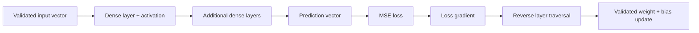
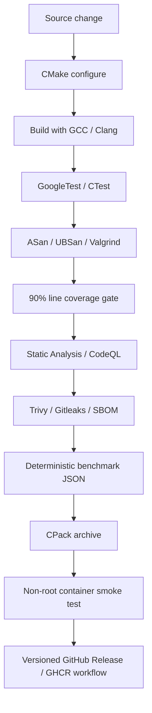

# Neural Network from Scratch in C++

<p align="center">
  <a href="https://github.com/CoreyLeath-code/neural-network-from-scratch-cpp/actions/workflows/ci.yml"></a>
  <a href="https://github.com/CoreyLeath-code/neural-network-from-scratch-cpp/actions/workflows/static-analysis.yml"></a>
  <a href="https://github.com/CoreyLeath-code/neural-network-from-scratch-cpp/actions/workflows/security.yml"></a>
  <a href="https://github.com/CoreyLeath-code/neural-network-from-scratch-cpp/actions/workflows/codeql.yml"></a>
  <a href="https://github.com/CoreyLeath-code/neural-network-from-scratch-cpp/actions/workflows/release.yml"></a>
</p>

<p align="center">
  
  
  
  
  
  
</p>

A compact feed-forward neural network implemented with the C++17 standard library—without a tensor or
machine-learning framework. The repository keeps forward propagation, backpropagation, gradient descent,
initialization, loss calculation, validation, and memory ownership visible while surrounding the core
algorithm with reproducible build, test, security, benchmark, container, and release controls.

> **Scope:** this is an educational and research implementation. It is intentionally not presented as a
> replacement for Eigen, BLAS-backed tensor libraries, PyTorch, TensorFlow, or a production model-serving
> runtime.

## At a glance

| Area | Current implementation |
| --- | --- |
| Language | C++17 |
| Build | CMake + Ninja-compatible build graph |
| Model | Configurable dense feed-forward network |
| Activations | Sigmoid, ReLU, tanh |
| Loss | Mean squared error |
| Training | Online gradient descent with analytic backpropagation |
| Data | Strict bounded numeric CSV ingestion |
| Testing | GoogleTest/CTest, XOR regression, negative/boundary tests |
| Memory safety | ASan, UBSan, Valgrind |
| Quality gate | GCC + Clang, warnings-as-errors, 90% line coverage |
| Security | CodeQL, Trivy, Gitleaks, CycloneDX SBOM |
| Performance evidence | Deterministic inference benchmark with JSON output |
| Packaging | CPack `.tar.gz` archive |
| Container | Multi-stage Ubuntu 26.04 image, non-root UID 10001 |
| Release automation | GitHub Release assets + GHCR image on successful release workflow |

## Implemented scope

- Dense layers with deterministic Xavier-uniform initialization.
- Numerically stable sigmoid, ReLU, and tanh activation functions.
- Mean squared error with analytic gradient.
- Online gradient descent and configurable connected topology.
- Strict numeric and topology validation.
- Rejection of non-finite or overflowing parameter updates before mutation.
- Strict, bounded CSV ingestion with malformed-input failure paths.
- Deterministic XOR end-to-end learning regression.
- Reproducible inference benchmark reporting min, mean, median, P95, P99, max, and throughput.
- GCC/Clang CI, GoogleTest, 90% line-coverage enforcement, ASan/UBSan, Valgrind, static analysis,
  CodeQL, secret scanning, SBOM generation, packaging, and container smoke testing.

Not implemented: mini-batching, autodiff graphs, GPU execution, SIMD/BLAS kernels, model serialization,
distributed training, checkpoint/recovery, or a network service/API.

## Architecture flowchart



`NeuralNet` owns layers through `std::unique_ptr`. Activations are immutable shared strategies. Each
`DenseLayer` stores a flattened row-major weight matrix and the most recent forward-pass state needed
for backpropagation. Input gradients are calculated before parameter mutation, and invalid numerical
updates fail closed.

See [`docs/architecture.md`](docs/architecture.md), [`docs/AUDIT.md`](docs/AUDIT.md), and
[`docs/adr/0001-ci-and-deployment-hygiene.md`](docs/adr/0001-ci-and-deployment-hygiene.md).

## System design flowchart



This design keeps algorithm correctness evidence separate from packaging and delivery evidence. A green
release pipeline does not imply scientific validity on unseen datasets; it means the repository's
implemented engineering contract passed its automated gates.

## Quick start

### Requirements

- CMake 3.16+
- A C++17 compiler such as GCC or Clang
- GoogleTest when building tests
- Ninja is optional locally but used by CI/release workflows

### Build, test, run

```bash
git clone https://github.com/CoreyLeath-code/neural-network-from-scratch-cpp.git
cd neural-network-from-scratch-cpp

cmake -S . -B build -DCMAKE_BUILD_TYPE=Release
cmake --build build --parallel
ctest --test-dir build --output-on-failure

./build/neural_network
./build/benchmark_network
```

### Sanitizer build

```bash
cmake -S . -B build-asan \
  -DCMAKE_BUILD_TYPE=Debug \
  -DNN_ENABLE_SANITIZERS=ON
cmake --build build-asan --parallel
ctest --test-dir build-asan --output-on-failure
```

### Coverage build

```bash
cmake -S . -B build-coverage \
  -DCMAKE_BUILD_TYPE=Debug \
  -DNN_ENABLE_COVERAGE=ON
cmake --build build-coverage --parallel
ctest --test-dir build-coverage --output-on-failure
```

CI captures line coverage with `lcov` and fails if the measured line coverage is below 90%.

## API example

```cpp
#include <memory>

#include "core/NeuralNet.hpp"
#include "impl/Activations.hpp"
#include "impl/Losses.hpp"

nn::NeuralNet network(std::make_unique<nn::MeanSquaredError>());
network.add_dense(2, 4, std::make_shared<nn::Tanh>(), 7);
network.add_dense(4, 1, std::make_shared<nn::Sigmoid>(), 11);

const double loss = network.train_sample({0.0, 1.0}, {1.0}, 0.25);
const nn::Vector prediction = network.predict({0.0, 1.0});
```

Inputs, targets, gradients, learning rates, dimensions, topology, and numeric values are validated.
Invalid states throw exceptions rather than silently corrupting model state.

## Evidence and reproducibility

The repository favors commands and artifacts that can be rerun over hand-entered performance claims.

| Evidence | Reproduction path | Expected output / gate |
| --- | --- | --- |
| Release build | `cmake -S . -B build -DCMAKE_BUILD_TYPE=Release` + build | Successful C++17 compilation |
| Unit/regression tests | `ctest --test-dir build --output-on-failure` | All discovered GoogleTests pass |
| Memory safety | Sanitizer build + Valgrind CI job | No blocking sanitizer/Valgrind findings |
| Coverage | Coverage CI job | Line coverage `>= 90%` |
| Inference benchmark | `./build/benchmark_network` | Machine-readable JSON |
| Package | `cmake --build build --target package` | Versioned `.tar.gz` CPack archive |
| Container | `docker build` + `docker run --rm` | Successful non-root smoke execution |
| Security | Security workflows | CodeQL/Trivy/Gitleaks gates + CycloneDX SBOM |

CI also uploads benchmark JSON, coverage data, generated packages, scanner output where configured, and
SBOM artifacts so evidence can be associated with a specific workflow run and commit.

## Research-style benchmark contract

The benchmark constructs a deterministic `32-64-16-4` network, executes **1,000 untimed warmup
inferences**, and then records **20,000 timed inference calls** using `std::chrono::steady_clock`.
Output includes:

- parameter count;
- minimum, mean, median, P95, P99, and maximum latency in microseconds;
- aggregate inferences per second.

Example command:

```bash
./build/benchmark_network | tee benchmark-results.json
```

Benchmark values are hardware-, compiler-, operating-system-, load-, and build-flag-specific. The
repository intentionally does **not** hard-code a portable latency or throughput claim from shared CI
runners. Compare runs only when the environment and benchmark protocol are materially equivalent.

See [`docs/benchmarks.md`](docs/benchmarks.md) and
[`benchmarks/benchmark_report.md`](benchmarks/benchmark_report.md).

## Correctness evidence

The test suite currently covers representative algorithm and boundary behavior, including:

- activation-function numerical behavior;
- MSE calculation and analytic gradient;
- deterministic dense-layer initialization;
- dimension and topology validation;
- backward-pass lifecycle checks;
- non-finite/overflowing update rejection without parameter mutation;
- deterministic XOR learning regression;
- valid, malformed, missing, and oversized CSV input handling.

The XOR regression is a deterministic integration signal, not proof of general gradient correctness or
real-world predictive quality. Finite-difference gradient checks across multiple shapes remain a roadmap
item.

## Container

```bash
docker build -t neuralnet-cpp:local .
docker run --rm neuralnet-cpp:local
```

The current multi-stage Dockerfile builds and runs on Ubuntu 26.04. The runtime executes as UID `10001`
rather than root and contains the installed `neural_network` executable as its entrypoint.

## Releases and packages

`CMakeLists.txt` declares project version `1.0.0` and configures CPack to produce a TGZ release archive.
The release workflow supports semantic-version tags matching `vMAJOR.MINOR.PATCH` and is configured to:

1. resolve an immutable release commit/tag;
2. build the release binary and CPack archive;
3. generate `SHA256SUMS.txt` for the archive;
4. create or refresh the corresponding GitHub Release assets;
5. build and push the container image to GHCR;
6. attach OCI source, revision, and version labels;
7. request container provenance and SBOM attestations.

After a successful release workflow, the image naming convention is:

```text
ghcr.io/coreyleath-code/neural-network-from-scratch-cpp:<release-tag>
```

Release publication is an engineering distribution mechanism; it does not upgrade the implementation's
scientific scope or remove the limitations documented below.

## Engineering guarantees and limitations

| Area | Current guarantee | Current limitation |
| --- | --- | --- |
| Reproducibility | Explicit seeds and fixed XOR ordering | Floating-point results can vary slightly by platform |
| Memory safety | RAII plus sanitizer and Valgrind gates | No formal verification |
| Numerical safety | Stable sigmoid, finite-value checks, guarded updates | No mixed precision or exhaustive overflow policy |
| Performance | Reproducible benchmark protocol and flattened weights | Scalar loops; no SIMD, BLAS, threading, or GPU |
| Data safety | Row/column bounds and strict numeric parsing | CSV only; no schema metadata or normalization contract |
| Concurrency | Deterministic single-instance execution | Forward cache makes one network instance non-reentrant |
| Persistence | None claimed | No model serialization or checkpointing |
| Serving | None claimed | No HTTP/gRPC service or authentication boundary |

## Repository map

```text
src/core/       Stable interfaces and shared vector type
src/impl/       Activations, loss, dense layer, network, CSV loader
tests/          Unit, negative, boundary, and XOR regression tests
benchmarks/     Reproducible inference harness and benchmark report
docs/           Architecture, audit, benchmark methodology, ADRs
.github/        CI, static analysis, security, CodeQL, release automation
Dockerfile      Multi-stage non-root container build
CMakeLists.txt  Build graph, test integration, install rules, CPack
```

## Audit status

The repository includes a maintained production-readiness audit in
[`docs/AUDIT.md`](docs/AUDIT.md). The audit explicitly separates implemented evidence from roadmap items
and records known technical debt such as scalar-only training, missing serialization, MSE-only loss,
non-reentrant forward caches, and absent SIMD/BLAS/GPU kernels.

## Roadmap

1. Add finite-difference gradient checks across multiple layer shapes.
2. Add stable softmax and cross-entropy.
3. Define versioned model serialization with corruption and size limits.
4. Add mini-batch abstractions and deterministic shuffle policies.
5. Profile representative workloads before selecting SIMD, BLAS, or parallel kernels.
6. Establish benchmark history on stable runners before enforcing regression thresholds.
7. Add stronger release approval/signing controls when the project requires them.

Roadmap items are directional and must not be read as implemented capability claims.

## Contributing and security

Changes should include deterministic tests, preserve warnings-as-errors, and document numerical or
performance tradeoffs. Run tests and sanitizers before opening a pull request. See
[`SECURITY.md`](SECURITY.md) for vulnerability-reporting and supported-version guidance.

## License

[MIT](LICENSE). The software is provided for educational and research use without fitness guarantees.
